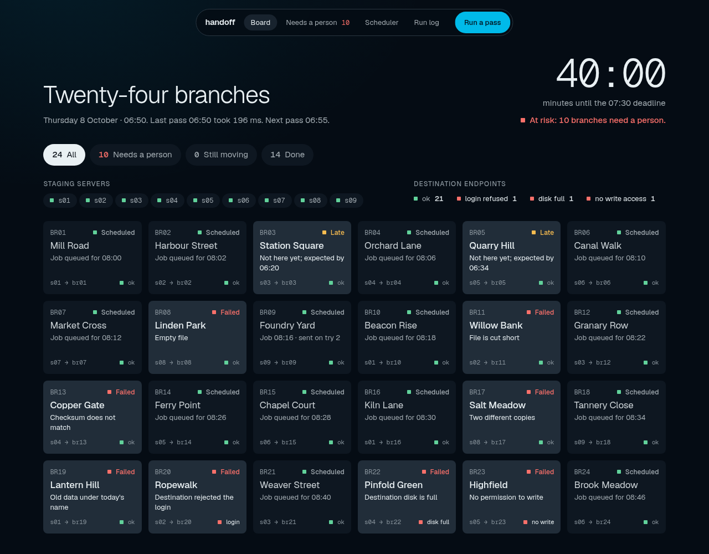
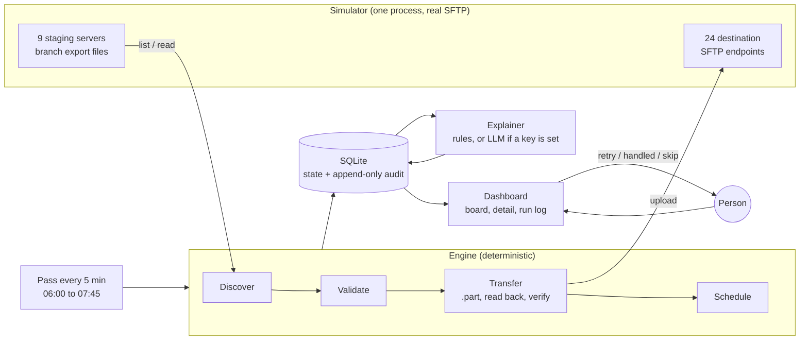
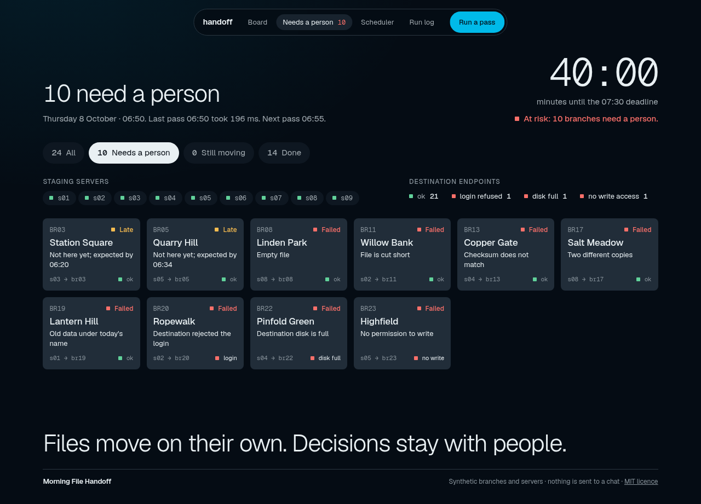
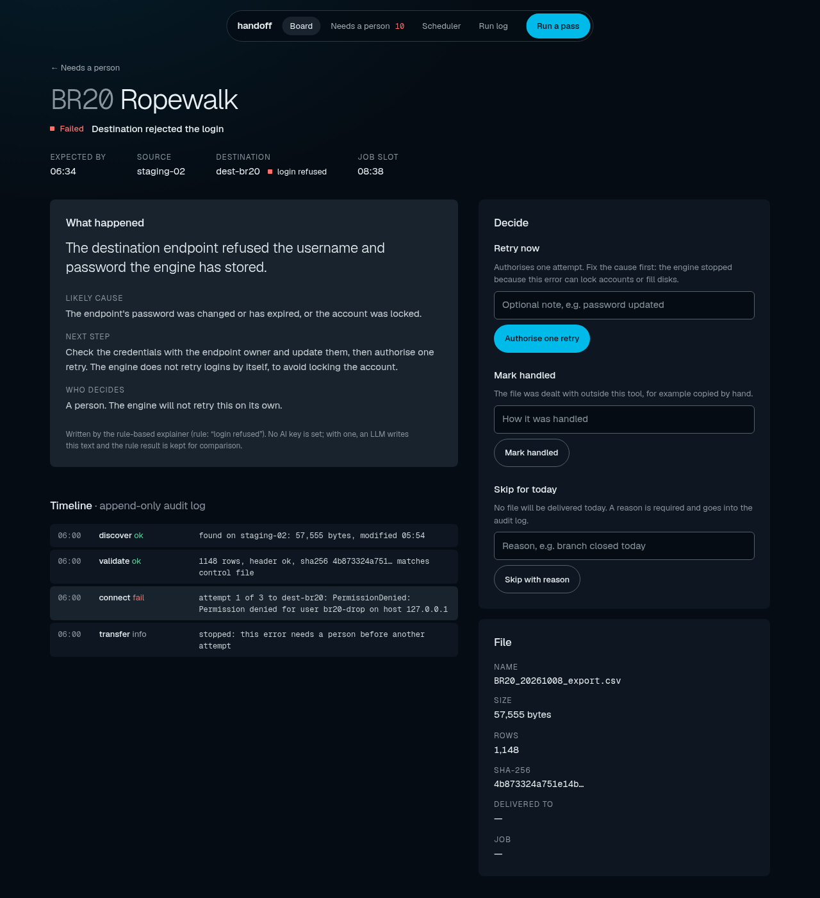
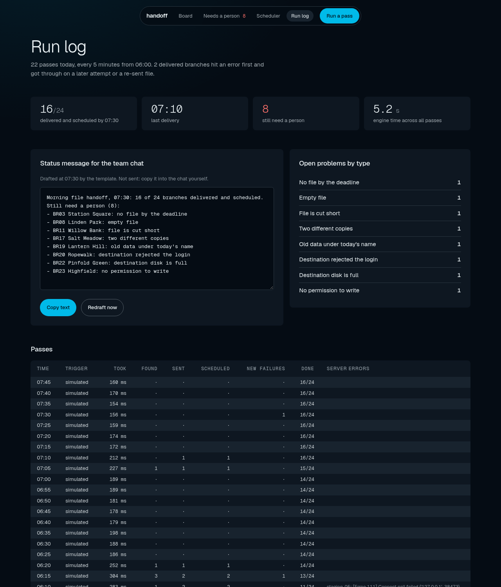

# Morning File Handoff

A side project about a common operations problem: every morning, many branches each produce one
export file, and someone has to find it, check it, copy it to the right place and book it for
processing before a hard deadline. This repo automates the repetitive part, explains the failures in
plain English, and leaves the judgement calls to people.

Everything here is synthetic: the branches, servers, file contents and failures are generated by the
included simulator. The project is not used by any company.



## The problem

The scenario this models (taken from the problem description, not measured here): **5–6 people work
from about 06:00 to 07:30** to

1. check about 24 branch consoles and search about 9 staging servers for each branch's daily export,
2. copy each file to that branch's destination SFTP endpoint (about 24 of them),
3. schedule each file in a separate scheduler application,
4. finish everything by a hard 07:30 deadline.

Most mornings most files are fine. The time goes into the searching and copying, and the risk sits in
the few files that are missing, late, broken or blocked by a destination problem.

## What it does

Every 5 minutes from 06:00 the engine runs one **pass**:

1. **Discover.** Lists all 9 staging servers and looks for `BRxx_YYYYMMDD_export.csv` and its `.ctl`
   control file. A file found on two servers is fine if both copies are identical; different copies
   are flagged.
2. **Validate.** The file must exist, be non-empty, have the expected header, match the row count and
   SHA-256 in the control file, and contain rows for today (not yesterday's data under today's name).
3. **Transfer.** Uploads to the branch's destination over SFTP as a `.part` file, reads it back,
   checks size and SHA-256, then renames it into place. Up to 3 attempts with backoff for network
   errors.
4. **Schedule.** Books a job in the built-in queue (one per branch per day, enforced by a unique key).
5. **Audit.** Every step is written to an append-only log (found / validated / sent / verified /
   scheduled, plus failures and human actions). SQLite triggers reject updates and deletes.

Passes are **idempotent**: finished branches are skipped, a file already at the destination with the
same checksum is never uploaded again (also after a crash with a fresh database), and the queue
refuses a second job for the same branch and day. If a different copy of an already-delivered file
appears later, the branch is flagged for a person; nothing is re-sent automatically.

Errors that can make things worse if retried blindly (**login refused, destination disk full, no
write permission**) stop that branch until a person authorises one retry. These are recognised from
the SFTP error type (and, for disk full, also the server's error text), never by the AI.

The **dashboard** shows a board of the 24 branches, staging and destination health, a countdown to
07:30 with an at-risk warning, a "needs a person" filter, each branch's timeline and explanation, the
actions (retry, mark handled, skip with a reason) and a run log with a drafted team-chat summary.



## Who decides what

| | AI (or rule-based fallback) | Automated, deterministic | A person decides |
|---|---|---|---|
| Finding files on staging servers | | ✓ | |
| Validating header, rows, checksum, date | | ✓ | |
| Uploading, verifying, retrying network errors | | ✓ | |
| Booking the job in the queue | | ✓ | |
| Explaining a failure: likely cause, next step | ✓ | | |
| Drafting the 07:30 team-chat summary | ✓ (drafted only, never sent) | | |
| Retrying after a login, disk-full or permission error | | | ✓ |
| Choosing between two different copies of a file | | | ✓ |
| Manual overrides: mark handled, skip with a reason | | | ✓ |
| Contacting a branch about a missing or broken file | | | ✓ |
| Sending the team-chat summary | | | ✓ (copy and paste) |

The LLM never decides whether a file is sent. It receives the failure facts after the engine has
acted and returns text in a fixed JSON shape. If no key is set, or the call fails, a rule-based
classifier (regular expressions on the failure stage and message) picks one of 15 categories and
fills a written template. The dashboard says which one wrote each explanation.

## The simulated environment

The SFTP servers are real, but they are local. `handoff/sftp_farm.py` uses
[asyncssh](https://asyncssh.readthedocs.io/) to run **33 SFTP listeners in one Python process** on
127.0.0.1: 9 staging servers and 24 destinations. Each listener has its own port, its own chroot
directory and its own password. They share one generated host key, and the client pins it through a
generated `known_hosts` file (an unknown host key is rejected; there is a test for that). The engine
talks to them with an ordinary SFTP client, so the transfer code does not know it is a simulation.

The generator writes CSV exports with a header, a row count and a SHA-256 in a control file, and
injects these failures:

| Injected failure | How it is produced |
|---|---|
| missing | no file is ever written |
| late | file arrives after the branch's expected time |
| empty | zero-byte CSV |
| truncated | CSV cut short, so rows and checksum do not match the control file |
| checksum mismatch | content changed after the control file was written |
| duplicate across staging servers | same name on two servers, with identical or different contents |
| stale | yesterday's rows under today's file name |
| destination auth failure | the engine holds the wrong password for that endpoint |
| disk full | the destination server raises "no space" on write |
| permission error | the destination server refuses writes |
| network blip | the connection is dropped on the first write, once |
| offline staging server | a staging listener is stopped and started again later |

## Measured results

All numbers come from runs of the simulator on one machine, with `HANDOFF_LLM=off` (the rule-based
explainer). The raw output is in [`docs/results/`](docs/results/).

**Demo morning** (`python -m handoff simulate`, a deliberately failure-heavy scenario: 11 of 24
branches have an injected problem, plus noise such as an offline staging server until 06:15 and a
control file that arrives late):

| | Result |
|---|---|
| Passes run | 22 (06:00 to 07:45, every 5 minutes) |
| Delivered and scheduled by 07:30 | **16 of 24** |
| Branches with no injected problem | 13 of 13 scheduled, the last at 06:20 |
| First pass (06:00) | 8 branches scheduled, 1.0 s wall time |
| Last delivery | 07:10 (a corrected re-send of a file that first failed its checksum) |
| Late file | arrived 07:02, delivered on the 07:05 pass |
| Network blip | recovered on the second attempt |
| Left for a person at 07:30 | 8: missing, empty, truncated, different duplicates, stale, login refused, disk full, no write permission |
| Engine time, all 22 passes | 5.4 s in total, median pass 0.2 s |
| Deliveries counted by the destination servers | 32 (16 CSV + 16 control files), 0 duplicate jobs |
| Failures classified correctly (rule-based) | 11 of 11, no false alarms on clean branches |

Failures caught, by type: late 2 (one later became missing), missing 1, empty 1, network 1,
truncated 1, checksum mismatch 1, different duplicates 1, stale 1, login refused 1, disk full 1,
permission denied 1.

**30 random mornings** (`python -m handoff batch --mornings 30 --seed 100`): 88 injected failures
across 720 branch-mornings. The rule-based classifier labelled **88 of 88** correctly, all 632 clean
branch-mornings were scheduled with no false alarms, and there were 0 duplicate jobs.

The first run of this batch scored 86 of 88 and found a real gap: when the second, different copy of
a file arrived *after* the first copy had already been delivered, the engine never noticed. The engine
now re-checks delivered files on every pass and flags a person if a different copy appears. The
before-fix output is kept in `docs/results/batch-30-mornings-before-watch-fix.json`.

**Read these numbers with care.**

- The classifier reads error messages produced by the same simulator that injected the failures, so
  100% mostly shows the rules cover the simulated cases. Real servers word errors differently.
- Localhost transfers of files around 50 KB say nothing about real network latency.
- There is no measured comparison with manual work. The only manual-effort figure in this README is
  the one from the problem description (5–6 people, 06:00–07:30).
- The LLM path was not run for these results (no API key was used). It is covered by tests with a fake
  provider only.

## How to run

Needs Python 3.12 or newer.

```bash
python -m venv .venv && . .venv/bin/activate
pip install -r requirements.txt
cp .env.example .env            # optional; every setting has a default
```

| Command | What it does |
|---|---|
| `python -m handoff demo` | Starts the 33 local SFTP servers, a fast clock (10× from 05:58) and the dashboard at http://127.0.0.1:8000. Ctrl+C stops everything. |
| `python -m handoff simulate --out results.json` | Runs the demo morning headless, pass by pass, and prints the measured results. |
| `python -m handoff batch --mornings 30 --seed 100` | Runs random mornings and measures the classifier. |
| `python -m handoff topology` | Writes the default topology to `config/` (9 staging servers, 24 branches). |
| `python -m handoff serve` | Dashboard plus scheduled passes against the endpoints in `config/` (real clock). |
| `python -m handoff run` | One pass now against the configured endpoints. |
| `pytest` | Runs the tests (81, including real SFTP transfers on local ports). |
| `scripts/screenshots.sh` | Rebuilds two frozen-clock databases and captures the screenshots (needs Playwright). |

To point `serve` or `run` at real servers, edit `config/topology.json` and `config/branches.csv`,
put passwords in a credentials JSON file (`HANDOFF_CREDENTIALS`) or in `HANDOFF_PASSWORD_<ENDPOINT>`
environment variables, and provide a `known_hosts` file (`HANDOFF_KNOWN_HOSTS`). This path is tested
only against the local simulator.

### AI explanations (optional)

Set `OPENAI_API_KEY` or `GEMINI_API_KEY` in `.env`. `HANDOFF_LLM` can be `auto` (default), `openai`,
`gemini` or `off`. The model gets the branch, the failure stage and message, the branch's timeline
and the rule-based category, and must answer in a fixed JSON schema. Any error falls back to the rule-based text, and
the error is recorded. The 07:30 summary is stored as a draft on the run log page with a copy button.
Nothing is ever sent anywhere.

## Screenshots

| | |
|---|---|
|  Board at 06:50 |  "Needs a person" filter |
|  Branch detail with explanation |  Run log and drafted summary |

## Project layout

```
handoff/
  engine.py        one pass: discover, validate, transfer, verify, schedule
  exportfile.py    CSV + control file format and validation
  sftp_client.py   SFTP client helpers (.part upload, read-back verification)
  sftp_farm.py     the 33 local SFTP servers used by the simulator and tests
  generator.py     synthetic exports and injected failures
  simulate.py      runs a whole morning and measures it
  classify.py      rule-based failure categories and templates
  llm.py, explain.py   optional LLM explanations and the 07:30 summary draft
  scheduler.py     built-in job queue and the 5-minute pass loop
  actions.py       human actions: authorise retry, mark handled, skip, reopen
  db.py            SQLite schema and the append-only audit log
  web.py, templates/, static/   FastAPI dashboard
tests/             pytest suite
docs/results/      measured output of the simulator runs
```

## Limitations

- **Simulated only.** Everything ran against local servers on one machine. Real networks, real
  servers and real export files will behave differently.
- **Easy error text.** The classifier's accuracy reflects messages the simulator itself produces. For
  example, a real OpenSSH server usually reports a full disk as a generic "Failure". The engine would
  then retry it like a network error, give up after 3 attempts, and the rules would label it unknown
  instead of stopping it for a person.
- **LLM not evaluated.** The OpenAI and Gemini code paths are tested with a fake provider only.
- **Read-back verification doubles the transfer** for each file. That is fine for files of this size
  but worth revisiting for large ones.
- **Password authentication** is used in the simulator. Real deployments should use SSH keys; the
  client would need a small change.
- **Local wall-clock times** with no time zone handling.
- **The built-in queue only records jobs** and marks them due at their slot. It does not run them or
  talk to an external scheduler.
- **No login on the dashboard.** It binds to 127.0.0.1 by default and is meant for a trusted network.
- **One process.** No locking across several engine instances.
- **The demo scenario is failure-heavy on purpose**, so the board has something to show. It is not a
  model of a typical morning.
- n8n or another workflow tool was considered but not used; the 5-minute loop is plain Python.

## License

MIT. See [LICENSE](LICENSE).
